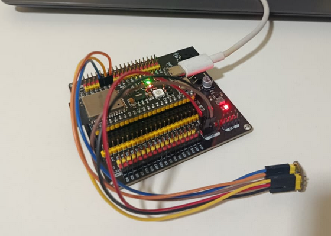
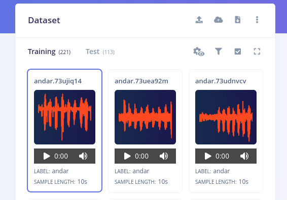
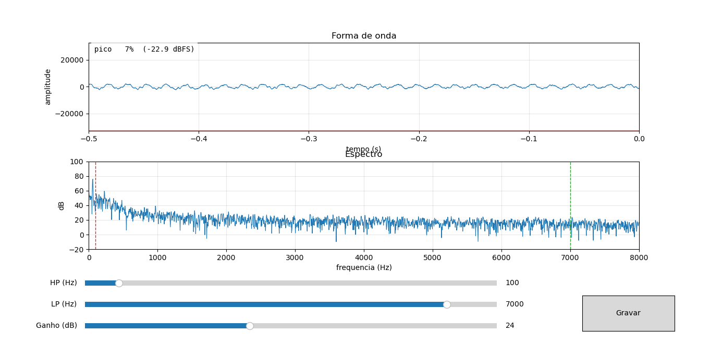

# esp32s3-audio-capture

Código para **ESP32-S3** que captura áudio do microfone **INMP441** e envia as amostras via terminal para o **Edge Impulse Data Forwarder**, para coleta de dados de treino de **tinyML**.

<div align="center">
  
</div>

## Instalação do Edge Impulse CLI

Requer Node.js 20 ou superior.

```bash
npm install -g edge-impulse-cli
```
## Como usar

1. Grave o código na placa.
2. Rode o Data Forwarder, usando **o mesmo baud rate**:
```bash
   edge-impulse-data-forwarder --clean --baud-rate 2000000 --frequency 16000
```
3. Informe usuário e senha do Edge Impulse e dê o nome `audio` ao eixo detectado.
4. No Studio, vá em **Data acquisition**, escolha o dispositivo, defina o label e a duração e inicie a captura.

<div align="center">
  
</div>

# Interface de Ajustes
```bash
   pip install pyserial numpy matplotlib
   python mic_monitor.py
```
<div align="center">
  
</div>

## Filtro Passa-Alto (High-Pass)

- **Função:** Filtro que permite a passagem de frequências acima de uma frequência de corte específica ($f_{HP}$), bloqueando ruídos graves e componentes de corrente contínua (DC).
- **Característica:** É recursivo. Utiliza as amostras e estados anteriores regidos pela taxa de amostragem ($f_s$) para fazer o cálculo atual.
- **Coeficiente ($\alpha_{HP}$):** Controla a inércia do filtro para bloquear baixas frequências, calculado pela função exponencial:

$$
\alpha_{HP} = e^{-2 \pi \frac{f_{HP}}{f_s}}
$$

## Filtro Passa-Baixo (Low-Pass)

- **Função:** Permite a passagem de frequências abaixo da frequência de corte ($f_{LP}$) e atenua as frequências (agudos) acima dela, prevenindo distorções de *aliasing*.
- **Característica:** Também possui uma estrutura recursiva, calculando o peso que a nova amostra terá sobre o valor acumulado no histórico.
- **Coeficiente ($\alpha_{LP}$):** Atua de forma complementar ao decaimento puro, sendo calculado como:

$$
\alpha_{LP} = 1 - e^{-2 \pi \frac{f_{LP}}{f_s}}
$$

Onde:

- $f_{HP}$ = `HP_CUTOFF` (frequência de corte do passa-alto)
- $f_{LP}$ = `LP_CUTOFF` (frequência de corte do passa-baixo)
- $f_s$ = `SAMPLE_RATE` (taxa de amostragem)
